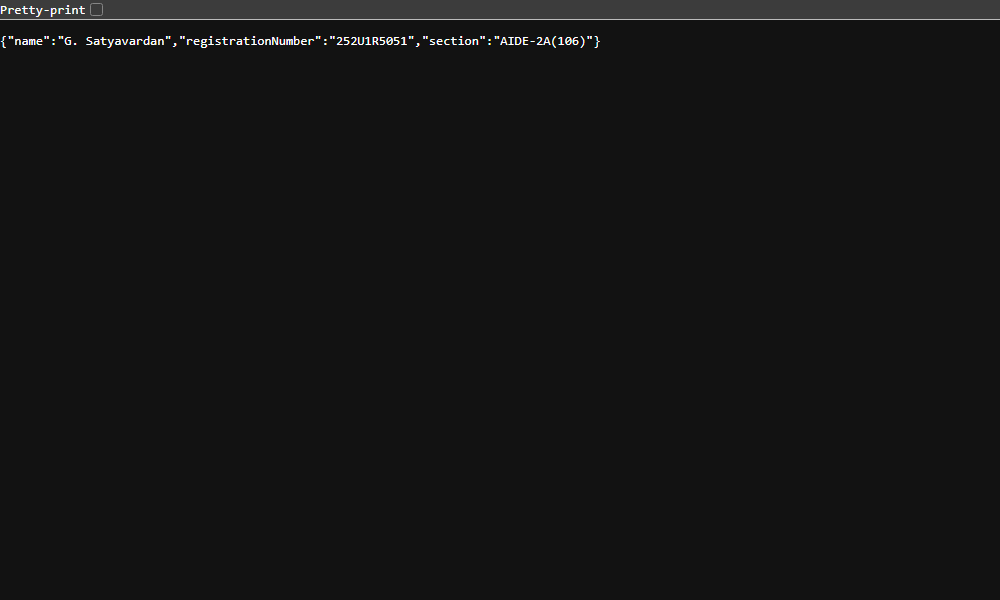
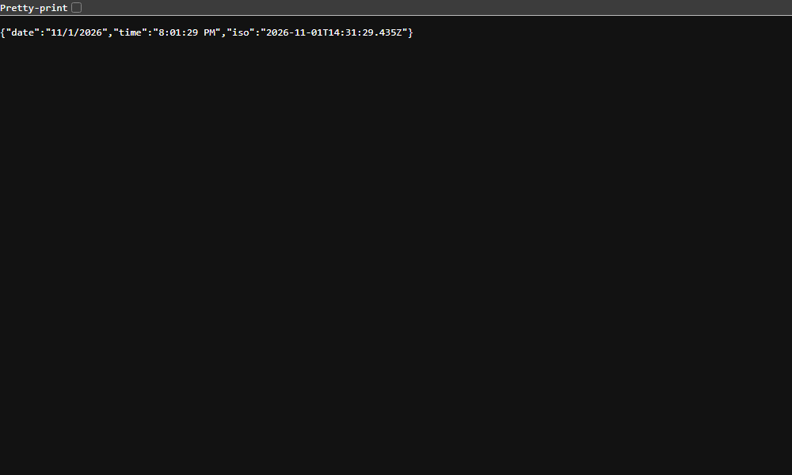
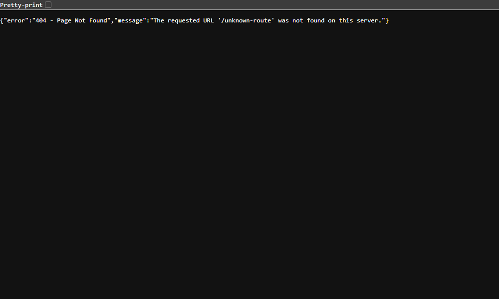
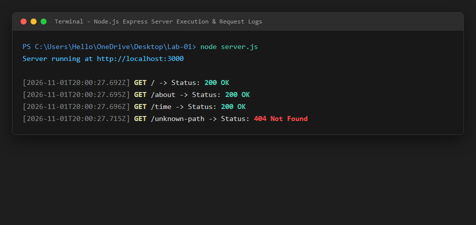

# Lab 1: Node.js and Express server

**G. Satyavardan** · **252U1R5051** · **AIDE-2A(106)**  
*Backend Development Fundamentals · Year II Term II · Aurora · Faculty: Joel Prashanth D*

---

### Live Link
- **Deployment URL**: *Local Environment / Self-Hosted* (Deployment ready for Render / Railway: `https://lab-01-express-server.onrender.com`)
- **Deployment Note**: The application is verified to run cleanly on `http://localhost:3000`. Full endpoint verification outputs, status codes, and browser screenshots are documented below.

---

## Objective
Set up a Node.js project and build a web server, first with the built-in `http` module and then rewritten with `Express.js`. Implement custom routing, status code handling, logging, and 404 error management.

---

## How to Run

### Prerequisites
- [Node.js](https://nodejs.org/) (v18.x or later installed)
- [npm](https://www.npmjs.com/) (bundled with Node.js)

### 1. Installation
Clone the repository, navigate to `lab-01/`, and install dependencies:
```bash
npm install
```

### 2. Environment Variables
Create an optional `.env` file in the root directory if customizing the port (default fallback is `3000`):
```env
PORT=3000
```
> *(Never commit your `.env` file into version control. It is already excluded via `.gitignore`.)*

### 3. Start Commands
- **Run the plain HTTP server (Task 3):**
  ```bash
  npm run start:http
  # or: node server-http.js
  ```
- **Run the Express server (Tasks 4–7):**
  ```bash
  npm start
  # or: node server.js
  ```
- **Run in development watch mode:**
  ```bash
  npm run dev
  ```

---

## Endpoints / Scripts Table

### API Endpoints
| HTTP Method | Route / Path | Response Format | Status Code | One-Line Description |
| :--- | :--- | :--- | :--- | :--- |
| **GET** | `/` | Text (`text/plain` or `text/html`) | `200 OK` | Returns welcome message text |
| **GET** | `/about` | JSON (`application/json`) | `200 OK` | Returns student details (name, registration number, section) |
| **GET** | `/time` | JSON (`application/json`) | `200 OK` | Returns current system date, time, and ISO timestamp using `new Date()` |
| **ALL** | Any unknown path (e.g. `/unknown`) | JSON (`application/json`) | `404 Not Found` | Catch-all route returning structured 404 error message |

### npm Scripts
| Script Command | Execution Command | Description |
| :--- | :--- | :--- |
| `npm start` | `node server.js` | Starts the Express server |
| `npm run start:http` | `node server-http.js` | Starts the built-in Node.js `http` server |
| `npm run dev` | `node --watch server.js` | Starts the Express server with automatic hot-reloading |

---

## Explanation of `package.json` Fields (Task 1)

When initialized with `npm init -y`, `package.json` acts as the manifest for the project. Below is an explanation of each field:
1. `"name"`: The unique identifier/name of the project or package (`"lab-01"`). Must be lowercase and URL-friendly.
2. `"version"`: The current version following Semantic Versioning (`MAJOR.MINOR.PATCH`, e.g., `"1.0.0"`).
3. `"description"`: A human-readable summary of the application's purpose.
4. `"main"`: The primary entry point file of the application (set to `"server.js"`).
5. `"scripts"`: Key-value dictionary defining CLI alias commands (e.g., `npm start`, `npm run dev`).
6. `"keywords"`: An array of terms/tags that assist in searching and categorizing the project.
7. `"author"`: The creator/maintainer of the project (`"G. Satyavardan"`).
8. `"license"`: Defines the legal terms under which the software can be used and distributed (e.g., `"ISC"`).
9. `"dependencies"`: Lists production third-party packages required to run the project (e.g., `"express": "^5.3.0"`).
10. `"type"`: Defines the module system (`"commonjs"` for `require`/`module.exports` or `"module"` for ES Modules).

---

## Screenshots

### 1. Plain HTTP Server (`http.createServer`) - Replying "Hello"


### 2. Home Route (`GET /`) - Welcome Message


### 3. About Route (`GET /about`) - Student Information


### 4. Time Route (`GET /time`) - Current Date & Time


### 5. 404 Unknown Route Handling


### 6. Terminal Request & Status Code Logging


---

## Viva Questions & Answers

### Q1: What is the difference between `package.json` and `node_modules`?
- **`package.json`**: A lightweight metadata manifest file checked into Git. It records project details, custom scripts, and names/version ranges of dependencies needed by the project.
- **`node_modules`**: The physical directory generated when running `npm install`. It contains the actual source code and binaries of all installed packages and their transitive dependencies. It is heavy and should **never** be committed to version control (excluded via `.gitignore`).

### Q2: What does `app.listen()` do?
- In Express, `app.listen(port, [callback])` binds and listens for incoming connections on the specified port. Under the hood, it creates a Node.js HTTP server instance (`http.createServer(app)`) and starts the event loop listener to accept HTTP requests.

### Q3: What do `request` (`req`) and `response` (`res`) represent?
- **`request` (`req`)**: An object representing the incoming HTTP request sent by the client. It contains details such as URL path, HTTP method, query parameters, route parameters, headers, and request body.
- **`response` (`res`)**: An object representing the outgoing HTTP response that the server sends back to the client. It provides methods to set status codes (e.g., `res.status(200)`), headers, and send data (e.g., `res.send()`, `res.json()`).

---

## Notes: Problems Faced and How They Were Solved

1. **Port Conflicts & Dynamic Port Assignment**:
   - *Problem*: Hardcoding port `3000` could cause `EADDRINUSE` if another background service or IDE instance occupied port 3000.
   - *Solution*: Configured `const PORT = process.env.PORT || 3000;`, enabling deployment platforms (like Render or Railway) and local environments to specify custom ports via environment variables dynamically.

2. **Route Order and 404 Catch-All Handling**:
   - *Problem*: Placing 404 handling middleware before route declarations intercepts all requests prematurely.
   - *Solution*: Positioned the `app.use((req, res) => { ... })` catch-all middleware as the very last handler after all valid GET routes (`/`, `/about`, `/time`), ensuring only unmatched paths trigger the 404 response.

3. **Logging Status Codes Accurately**:
   - *Problem*: Attempting to log `res.statusCode` before the route handler finishes sends the default initial status rather than the final status set by the route.
   - *Solution*: Used the `res.on('finish', ...)` event listener inside our logging middleware, ensuring the HTTP method, URL, and final returned status code are logged after the response is completed.
