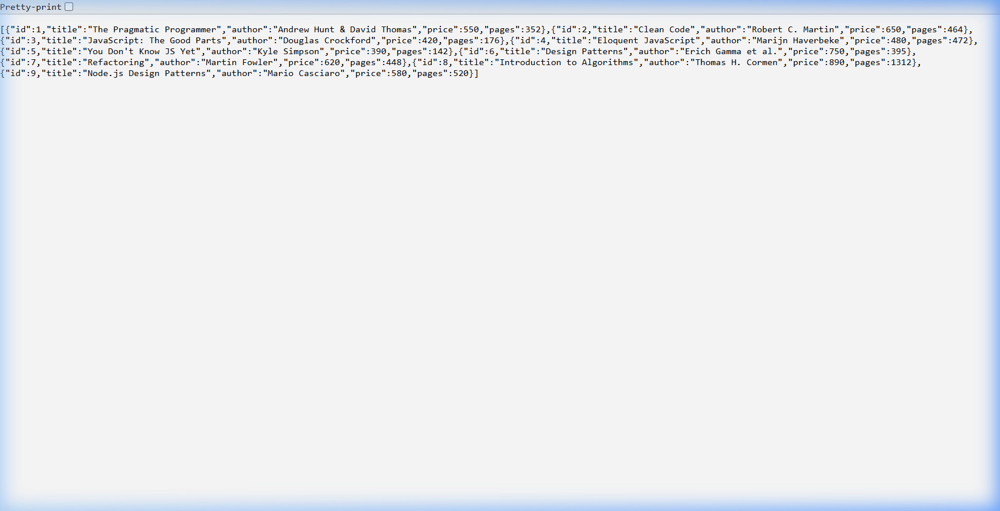
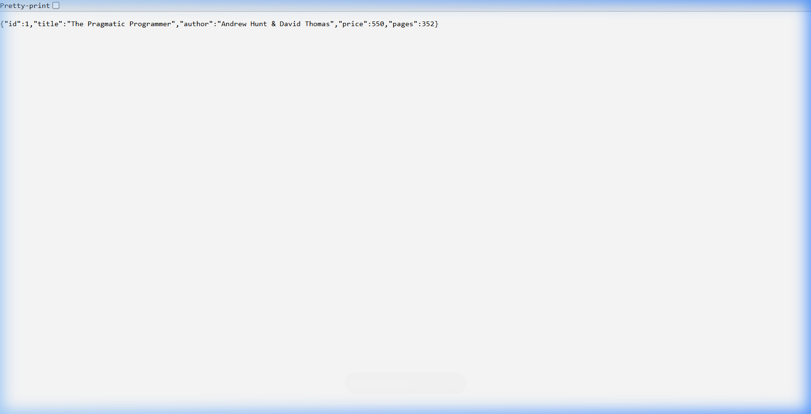
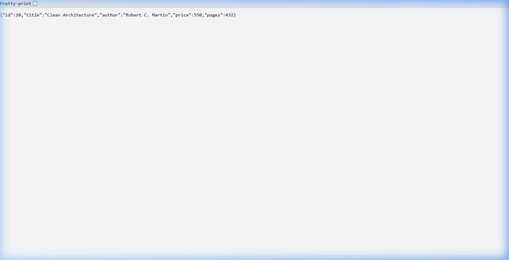
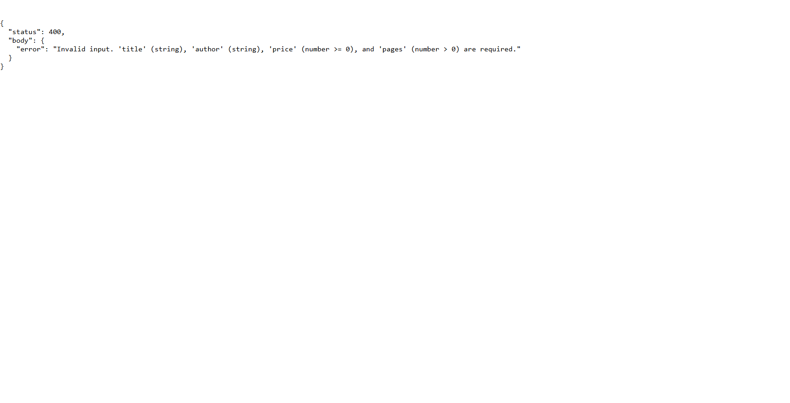

# Lab 2: SQLite Database and CRUD Routes

## Student Details

- **Name:** G. Satyavardan
- **Registration Number:** 252U1R5051
- **Section:** AIDE-2A(106)
- **Course:** Backend Development Fundamentals · Year II Term II · Aurora (Faculty: Joel Prashanth D / Mr. Siva sai Teja)

## Live Link

- **[https://lab-02-sqlite-server.onrender.com](https://lab-02-sqlite-server.onrender.com)** *(Render Blueprint deployment via root `render.yaml`)*

## Project Description

This project implements a RESTful API for a book management system using Node.js, Express, and SQLite. It provides complete CRUD (Create, Read, Update, Delete) operations with parameterized queries to prevent SQL injection, and starts the Express server only after establishing a verified database connection.

## Requirements

- **Runtime:** Node.js (v18+)
- **Packages:**
  - `express`: Minimalist web framework for Node.js
  - `sqlite`: Promise-based wrapper for SQLite
  - `sqlite3`: Native SQLite3 driver
  - `nodemon` (devDependencies): Development server with hot-reload

## How to Install and Run

1. Navigate to the `lab-02` directory:
   ```bash
   cd lab-02
   ```

2. Install dependencies:
   ```bash
   npm install
   ```

3. Initialise the database (first time only):
   ```bash
   node init-db.js
   ```

4. Run in development mode (with auto-restart via Nodemon):
   ```bash
   npm run dev
   ```

5. Run in production mode:
   ```bash
   npm start
   ```

6. Run automated test suite:
   ```bash
   npm test
   ```

The server will be available at `http://localhost:3000`.

*Environment Variables:* None required. The server defaults to port `3000` (or `process.env.PORT` if set).

## Database

- **File Location:** `database/books.db`
- **Init Script:** `database/init.sql`

### Table Schema (`book`)

| Column | Type | Constraints |
|---|---|---|
| `id` | INTEGER | PRIMARY KEY |
| `title` | TEXT | |
| `author` | TEXT | |
| `price` | INTEGER | |
| `pages` | INTEGER | |

### Inspecting via SQLite CLI

```bash
sqlite3 database/books.db
```

Inside the SQLite prompt:
```sql
.tables
.schema book
SELECT * FROM book;
.exit
```

Initial seed data includes 9 sample books.

## Endpoints

| Method | Path | Description | Expected Status Codes |
|---|---|---|---|
| `GET` | `/books/` | Retrieve all books from the database | `200 OK` |
| `GET` | `/books/:bookId/` | Retrieve a single book by ID | `200 OK`, `404 Not Found`, `400 Bad Request` |
| `POST` | `/books/` | Insert a new book record | `201 Created`, `400 Bad Request` |
| `PUT` | `/books/:bookId/` | Update all editable fields of an existing book | `200 OK`, `404 Not Found`, `400 Bad Request` |
| `DELETE` | `/books/:bookId/` | Delete an existing book by ID | `200 OK`, `404 Not Found`, `400 Bad Request` |
| `ANY` | Unknown path | Catch-all handler for undefined routes | `404 Not Found` |

## Screenshots

### 1. GET All Books (`GET /books/`)


### 2. GET Single Book (`GET /books/1/`)


### 3. POST New Book (`POST /books/`)


### 4. GET Newly Created Book (`GET /books/10/`)


### 5. PUT Update Book (`PUT /books/10/`)


### 6. DELETE Book (`DELETE /books/10/`)


### 7. Non-Existent Book 404 (`GET /books/99999/`)


### 8. Invalid Input 400 (`POST /books/` with bad data)


---

## Notes: Problems Faced and How You Solved Them

1. **Database Connection Synchronization:**
   - *Problem*: If the server accepts requests before the database connection is established, handlers throw null pointer exceptions.
   - *Solution*: Encapsulated database initialization in `initializeDBAndServer()`. `app.listen()` is invoked only after the database connection and schema setup promises resolve.

2. **SQL Injection Prevention:**
   - *Problem*: Concatenating user inputs into SQL strings allows query manipulation and data tampering.
   - *Solution*: Every user-supplied value (`:bookId`, `title`, `author`, `price`, `pages`) is supplied as parameterized values using `?` placeholders.

3. **Input Validation & Proper HTTP Status Codes:**
   - *Problem*: Malformed requests (string instead of numeric ID, missing required fields) could lead to database errors or silent failures.
   - *Solution*: Added comprehensive parameter and payload validation returning `400 Bad Request` for invalid input, `404 Not Found` for nonexistent resources, and `201 Created` for new inserts.

---

## Viva Questions & Answers

### 1. Why await the database call?
> **Answer**: Database operations are I/O-bound asynchronous operations that return Promises. JavaScript uses a single-threaded non-blocking event loop. `await` halts the execution of the asynchronous handler until the database promise resolves, ensuring the server does not send an empty or incomplete response before data is retrieved or written, without blocking the event loop for other incoming requests.

### 2. What is SQL injection and how do placeholders prevent it?
> **Answer**: SQL Injection is an attack technique where malicious SQL commands are inserted into user input fields (e.g., `' OR '1'='1`). Parameterized queries with `?` placeholders pre-compile the SQL statement structure separately from the input parameters. The database engine treats values passed into placeholders strictly as literal data, never as executable code.

### 3. When is PUT used instead of POST?
> **Answer**:
> - **POST** is used to create a new resource on the server. It is non-idempotent (sending the same POST request multiple times creates multiple distinct records).
> - **PUT** is used to replace or update an existing resource at a specific URI (e.g., `/books/:bookId/`). It is idempotent (repeating the same PUT request multiple times leaves the resource in the exact same state as the first call).
